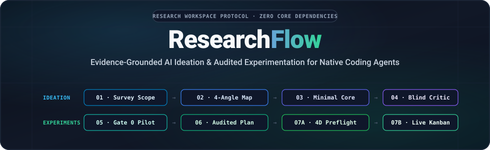
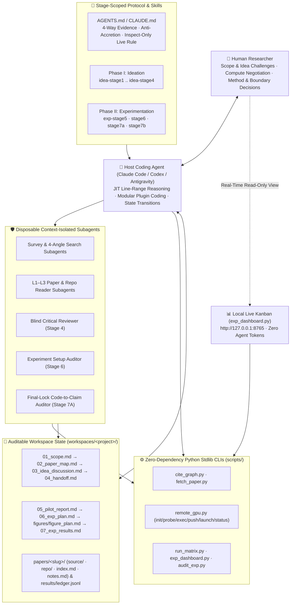

<p align="center">
  
</p>

<h3 align="center">
  <b>Don't Rebuild the Agent Runtime. Engineer How Coding Agents Conduct Real Scientific Research.</b>
</h3>

<p align="center">
  <a href="pyproject.toml"></a>
  <a href="LICENSE"></a>
  <a href="https://www.python.org/"></a>
  <a href="pyproject.toml"></a>
  <a href="AGENTS.md"></a>
  <a href="tests/"></a>
</p>

<p align="center">
  <b>🇺🇸 English</b> · <a href="docs/README_CN.md">🇨🇳 简体中文</a>
</p>

<p align="center">
  <a href="#-at-a-glance">At a Glance</a> ·
  <a href="#-why-researchflow">Why ResearchFlow?</a> ·
  <a href="#️-architecture">Architecture</a> ·
  <a href="#-the-8-stage-research-lifecycle">8-Stage Lifecycle</a> ·
  <a href="#️-system-comparison">Comparison</a> ·
  <a href="#-quick-start">Quick Start</a> ·
  <a href="#️-zero-dependency-cli-toolkit">CLI Toolkit</a>
</p>

---

## ✨ At a Glance

**ResearchFlow** is a lightweight **Research Workspace Protocol** designed to run natively inside modern coding agents (**Claude Code**, **Codex**, **Antigravity**). Instead of maintaining 70,000+ lines of brittle `while True: llm.chat()` plumbing, ResearchFlow equips your host coding agent with **stage-scoped scientific skills**, **context-isolated subagent audits**, and **zero-dependency Python stdlib CLIs**:

| Core Capability | What ResearchFlow Enforces | Failure Mode Eliminated |
| :--- | :--- | :--- |
| **📖 Lossless Primary Sources** | `fetch_paper.py` unpacks original arXiv `.tex`, `macros.tex`, and shallow-clones official GitHub repos with exact `file:Lstart-Lend` indices (`index.md`). | Lossy `Abstract → Card → Summary` telephone-game distortion. |
| **🧭 Zero-Blind-Spot Retrieval** | `cite_graph.py` merges S2 + OpenAlex across **3 temporal buckets** (`latest` / `mid-horizon` / `foundational`) + `--scan-bib` 2-hop `.bib` radar + `--arxiv-recent` zero-lag stream. | Missing 0-citation preprints, counter-evidence, or OpenReview competitors. |
| **🪒 Anti-Accretion & Blind Critic** | Caps novelty at **1–2 tightly coupled primitives**, separates `Baseline-Clean` bugfixes, and runs a history-isolated `Critical Reviewer` with coupled Python simulations. | 4-module "patchwork monsters" and confirmation-bias self-approval. |
| **🧪 Compute-Gated `Gate 0` Pilot** | Confirms compute upfront (never silently taxing the local host) and runs a 1–3h $2\times 2$ falsification pilot (`05_pilot_report.md`) *before* full benchmark design. | Burning 100 GPU-hours on an empirically dead or over-complicated idea. |
| **🛡️ 4D Preflight & Final-Lock Audit** | Modular plugin architecture, 4D hardware guards (`VRAM` + `CPU RAM` + `Disk` + `/tmp tmpfs`), real-data all-branch smoke via `remote_gpu.py exec`, and a **post-optimization** `Code-to-Claim` blind audit. | Strawman baselines, silent `batch_size` math drift, late-stage OOMs, and whack-a-mole patch regressions. |
| **📊 Zero-Token Live Kanban & Audit** | `exp_dashboard.py` serves a local real-time web Kanban over append-only `ledger.jsonl`, paired with **Inspect-Only** live run protection and `audit_exp.py` provenance checks. | Context-exploding `schedule` polling loops, unauthorized mid-run tampering, and hardcoded plot numbers. |

---

## 🔥 Recent Releases

- **`v0.3.1` — Battle-Hardened Experimentation & Live Kanban**: Added `Experiment Setup Auditor Subagent` (`stage6_exp_conventions.md`), `remote_gpu.py exec` quote-free runner & `/tmp` `tmpfs` isolation, modular plugin coding rules, reordered final-lock `Code-to-Claim` audit, **Inspect-Only** live run protection, optional on-demand runtime budgeting, and the zero-token live web dashboard [`exp_dashboard.py`](scripts/exp_dashboard.py).
- **`v0.3.0` — Full Experimentation Loop (Stages 5 → 7B)**: Added compute-gated `Gate 0` pilots, *Log Once, Slice Many* experiment/figure planning (`figure_plan.md`), conditional-equivalent hardware adaptation, multi-GPU queue runner [`run_matrix.py`](scripts/run_matrix.py), and post-run verifier [`audit_exp.py`](scripts/audit_exp.py).
- **`v0.2.0` — Ideation Hardening**: Added 3-tier citation balancing, `--scan-bib` 2-hop co-citation radar, `--arxiv-recent`, `--before-date` backtesting cutoffs, Occam anti-accretion caps, and coupled state-machine falsification reviews.

---

## 🤔 Why ResearchFlow?

Most open-source "autonomous research" pipelines promise *"One Command → One Full Paper."* When tested on real frontier ML topics, they break down in two predictable places:

### 1. Where Autonomous Pipelines Fail in **Ideation**
- **Shooting Before Drawing the Target**: Inventing a *"Novel Angle"* and *"Expected +8% Gain"* at Stage 1 before reading a single real paper.
- **800-Character Abstract Compression**: Stripping away theorem assumptions, custom LaTeX macros, appendix ablations, and undocumented tricks in official codebases.
- **Context Pollution & Sycophantic Drift**: Flooding a single chat window with raw searches until repeated context compactions cause amnesia and parameter-prior guessing.

### 2. Where Autonomous Pipelines Fail in **Experimentation**
- **Premature Toy Downgrading vs. Unbudgeted Cartesian Explosions**: Either collapsing LLM/vision ideas into 8-condition MLP toys, or scheduling 200+ runs by guessing peer dataset sizes without checking `8× H100` vs. `1× 24GB/48GB` conventions.
- **Silent Scientific Invalidation on OOM**: Halving `batch_size` on `CUDA OOM` without scaling `grad_accum_steps` or checking `optimizer.step()` / subspace-hook boundaries—changing optimization dynamics behind the researcher's back.
- **1,600-Line Monolithic God-Scripts & Early-Audit Drift**: Packing 15 baselines into one `if/elif` script where fixing memory for Baseline A breaks OOM recovery for Baseline B, after code review already finished.

> **Our Core Principle — Engineering Autonomy vs. Scientific Authority:**
> The **Agent** has full engineering autonomy to sync SSH environments, profile bottlenecks, recover from crashes, and render deterministic vector plots—but **zero unauthorized authority** to run heavy workloads on your local machine, alter scientific claims, tune on test splits, silently drop failed seeds, or kill/modify a live experiment without your explicit approval.

---

## 🏛️ Architecture



---

## 🔬 The 8-Stage Research Lifecycle

Each stage loads **only one active `SKILL.md`** and persists clean state files to `workspaces/<project>/`, letting you run `/compact` or open a fresh chat window between phases with zero context degradation.

### Phase I — Evidence-Grounded Ideation (`Stages 1 → 4`)

| Stage | Skill | Core Mechanism | Output Artifact |
| :--- | :--- | :--- | :--- |
| **Stage 1**<br/>Landscape & Scope | [`idea-stage1-landscape`](skills/idea-stage1-landscape/SKILL.md) | Survey-first taxonomy discovery (or **1–3 seed-paper fast-track**); formal prerequisite definitions before locking an `A → B → C` lineage branch. | `01_scope.md` |
| **Stage 2**<br/>4-Angle Paper Map | [`idea-stage2-literature-map`](skills/idea-stage2-literature-map/SKILL.md) | 3-tier citation graph + `--arxiv-recent` + OpenReview/Workshops + dual operators + mandatory counter-evidence + `--scan-bib` 2-hop `.bib` radar; parallel `L1–L3` source/repo audits. | `02_paper_map.md`<br/>`papers/*/notes.md` |
| **Stage 3**<br/>Parsimonious Ideation | [`idea-stage3-ideation`](skills/idea-stage3-ideation/SKILL.md) | Conflict/confound & repo-surgery lenses; **1–2 primitive complexity cap**; `Baseline-Clean` separation; mandatory component search-back; `Explore / Challenge / Refine / Pivot` tracking. | `03_idea_discussion.md` |
| **Stage 4**<br/>Blind Falsification | [`idea-stage4-review-handoff`](skills/idea-stage4-review-handoff/SKILL.md) | History-isolated `Critical Reviewer`: minimum-novel-core peeling, `L2` appendix scoop checks, elementary dominance check, coupled Python simulation, and `Gate 0` Go/No-Go design. | `04_handoff.md`<br/>`critical_review.md` |

### Phase II — Pilot Lock, Blueprint Design & Audited Execution (`Stages 5 → 7B`)

| Stage | Skill | Core Mechanism & Human Touchpoints (`⏸️`) | Output Artifact |
| :--- | :--- | :--- | :--- |
| **Stage 5**<br/>`Gate 0` Pilot Lock | [`exp-stage5-pilot`](skills/exp-stage5-pilot/SKILL.md) | `⏸️` **Confirm pilot GPU upfront** (never silently runs on host). Runs unit tests, 15s throughput/VRAM probe, and 1–3h $2\times 2$ pilot via `remote_gpu.py`. `⏸️` **Locks `GO / SIMPLIFY / PIVOT`**. | `05_pilot_report.md` |
| **Stage 6**<br/>Audited Exp Plan | [`exp-stage6-design`](skills/exp-stage6-design/SKILL.md) | Spawns `Experiment Setup Auditor` to verify peer dataset splits, GPU scale, and multi-model norms (`stage6_exp_conventions.md`); separates **GPU Runs** vs. **Zero-GPU Derived Views**; writes dual-track `figure_plan.md`; optional time budgeting. `⏸️` **Negotiates compute & scope**. | `06_exp_plan.md`<br/>`figures/figure_plan.md`<br/>`exp_manifest.json` |
| **Stage 7A**<br/>4D Preflight & Lock | [`exp-stage7a-coding`](skills/exp-stage7a-coding/SKILL.md) | Modular `methods/*.py` plugins + SHA-256 `eval_harness.py`; 4D guards (`VRAM` / `CPU RAM` / `Disk` / `/tmp tmpfs` / baseline latency); Gate 1 (`test_claims.py` + mock OOM) → Gate 2 (remote 2-step all-branch smoke via `remote_gpu.py exec`) → **Gate 3 (final-lock `Code-to-Claim` blind audit)**. | `experiments/*`<br/>`stage7a_code_audit.md` |
| **Stage 7B**<br/>Execution & Audit | [`exp-stage7b-execution`](skills/exp-stage7b-execution/SKILL.md) | Multi-GPU queue (`run_matrix.py`) over append-only `ledger.jsonl` (`invalidate` prevents version mixing); **zero-token live Kanban (`exp_dashboard.py`)**; **Inspect-Only** live run protection; vector `.pdf/.png` plotting + deterministic `audit_exp.py` gate. | `07_exp_results.md`<br/>`figures/*.pdf` |

---

## ⚖️ System Comparison

| Dimension | AutoResearchClaw | autoresearch (Karpathy) | Agentic Scientist (v3) | AgentLaboratory | AI-Researcher | **ResearchFlow** |
| :--- | :--- | :--- | :--- | :--- | :--- | :--- |
| **Runtime Architecture** | 23-stage custom pipeline (~71k LOC) | Host coding agent + `program.md` | Headless agents in Docker + `SKILL.md` | Custom multi-role Python loop | Custom Docker agent framework | **Host coding agent + Workspace Protocol (~4k LOC)** |
| **Literature & Source Fidelity** | 800-char truncated abstract cards | None (pure optimization loop) | Post-hoc citation fetch during writeup | 5-paper arXiv summary loop | Seed papers + paged `.tex` viewer | **3-tier graph + `.bib` radar + untouched `.tex` & `repo/` (`L0–L3`)** |
| **Experiment Design Grounding** | Hardcoded hardware prompt + `<=8` cond cap | Human pre-authors `prepare.py` | Human/task pre-authors `task.md` | Free-form dialogue | Single-model engineering plan | **Subagent-audited peer conventions + *Log Once, Slice Many* + `figure_plan.md`** |
| **Baseline & Hardware Fairness** | Rewrites baselines; halves `bs` on OOM without `grad_accum` | Run 0 unmodified `train.py`; `TOTAL_BS` invariant | Sealed RPC evaluator + matched method deadlines | Loose single script; LLM vibe-scores stdout | Bans direct repo imports; 2-epoch dev check | **Official `repo/` surgery + 3-tier params + verified conditional equivalence** |
| **Live Monitoring & Post-Run Audit** | Blocking foreground SSH; regex float check | `> run.log` + `grep`; `git reset` | GPU UUID leases + `.prov.json` `@evidence` | Captures stdout only (`stderr` lost) | Static LLM `Judge Agent` | **Detached SSH + zero-token Web Kanban + append-only `ledger.jsonl` + `audit_exp.py`** |

---

## ⚡ Quick Start

### 1. Clone & Optional Dev Setup

All core scripts under [`scripts/`](scripts/) use **100% Python 3.10+ standard library** and run out of the box with zero mandatory dependencies:

```bash
git clone https://github.com/legend91019/ResearchFlow.git
cd ResearchFlow

# Optional: install PyMuPDF (fallback for PDF-only papers without arXiv LaTeX source) + pytest
pip install -e ".[pdf,dev]"
```

*(Optional)* Configure academic API keys for higher rate limits:
```bash
export S2_API_KEY="your_semantic_scholar_key"   # Auto-falls back to OpenAlex on HTTP 429
export OPENALEX_EMAIL="you@university.edu"      # Joins OpenAlex polite pool
```

### 2. Open in Claude Code, Codex, or Antigravity

Open the `ResearchFlow/` folder in your coding agent. It automatically loads [`AGENTS.md`](AGENTS.md) / [`CLAUDE.md`](CLAUDE.md) and routes to the active stage skill.

#### Mode A — Start from a Broad Research Direction (`Stage 1 → 4`)
```text
I want to explore continual learning for LLMs with a 24GB–48GB single-GPU budget.
Initialize workspaces/cl_peft and start Stage 1 landscape research.
```

#### Mode B — Fast-Track from 1–3 Seed Papers (`Stage 2 → 4`)
```text
Starting from O-LoRA (arXiv:2310.14152) and InfLoRA (arXiv:2404.00228), initialize workspaces/ortho_cl
and jump directly into Stage 2 4-angle deep search and L1–L3 paper mapping.
```

#### Transitioning into Pilot, Design & Execution (`Stage 5 → 7B`)
> **Context Hygiene Tip**: Open a fresh chat window (or run `/compact`) when transitioning from Stage 4 (`04_handoff.md`) into Stage 5/6, and again before Stage 7A coding!
```text
Read workspaces/ortho_cl/04_handoff.md and follow ResearchFlow Stage 5 to prepare the Gate 0 pilot.
```

---

## 🛠️ Zero-Dependency CLI Toolkit

Every tool in [`scripts/`](scripts/) is standalone, deterministic, and built strictly on Python's standard library:

```bash
# 1. Literature Retrieval: 3-tier S2+OpenAlex graph, 2-hop .bib co-citation radar, zero-lag arXiv stream
python scripts/cite_graph.py 2310.14152 --direction both --limit 40 --out search_logs/olora.md
python scripts/cite_graph.py --scan-bib workspaces/demo --year-min 2024 --limit 25
python scripts/cite_graph.py --arxiv-recent "continual learning lora" --days 30

# 2. Lossless Paper Unpacking: unmodified .tex source + file:line index.md + shallow official repo clone
python scripts/fetch_paper.py --arxiv 2404.00228 --workspace workspaces/demo --slug 2024_inflora \
  --repo https://github.com/liangyanshuo/InfLoRA --role "Direct Baseline"

# 3. Remote GPU Management: zero-escape SSH key bootstrap, 4D hardware/tmpfs probe, stdin exec, tar sync
python scripts/remote_gpu.py init --workspace workspaces/demo --ssh "ssh -p 51263 root@gpu.host" --password-env RF_PW
python scripts/remote_gpu.py probe --workspace workspaces/demo
python scripts/remote_gpu.py exec --workspace workspaces/demo --script experiments/quick_smoke.py --gpu 0
python scripts/remote_gpu.py push --workspace workspaces/demo --src experiments
python scripts/remote_gpu.py launch --workspace workspaces/demo --job-id main_exp --workdir experiments \
  --cmd "python run_matrix.py run --manifest exp_manifest.json --ledger results/ledger.jsonl --gpus 0,1"

# 4. Zero-Token Live Web Kanban (http://127.0.0.1:8765) & Post-Run Provenance Auditor
python scripts/exp_dashboard.py --workspace workspaces/demo --job-id main_exp --port 8765
python scripts/audit_exp.py --manifest workspaces/demo/experiments/exp_manifest.json \
  --ledger workspaces/demo/experiments/results/ledger.jsonl --results-md workspaces/demo/07_exp_results.md
```

<details>
<summary>📂 <b>Click to inspect a full generated workspace directory layout</b></summary>

```text
workspaces/ortho_cl/
├── 01_scope.md                         # Taxonomy, compute envelope, locked A→B→C branch
├── 02_paper_map.md                     # Temporal lineage, confound matrix, benchmark index
├── 03_idea_discussion.md               # Verified facts vs. assumptions, minimal novel core
├── 04_handoff.md                       # Code coordinates, Gate 0 spec & Main Table targets
├── 05_pilot_report.md                  # Gate 0 empirical verdict (GO / SIMPLIFY / PIVOT) & ms/step baseline
├── 06_exp_plan.md                      # Plain-language guide, Execution Runs vs. Derived Views, 3-tier fairness
├── 07_exp_results.md                   # Audited results with <!-- @evidence:... --> provenance tags
├── figures/
│   ├── figure_plan.md                  # Dual-track chart specification & JSON field bindings
│   └── fig_e1.pdf / fig_e1.png         # Deterministically rendered vector & raster data plots
├── experiments/
│   ├── exp_manifest.json               # Locked condition queue & evaluator SHA-256
│   ├── eval_harness.py                 # Read-only split & metric evaluator
│   ├── runner.py                       # Shared conditional-equivalent loop & OOM backoff
│   ├── methods/                        # Isolated per-baseline & proposed plugin modules
│   ├── plots/                          # Zero-hardcoding matplotlib table & figure builders
│   ├── tests/test_claims.py            # Mechanism triggers, real-schema checks & mock-OOM tests
│   └── results/ledger.jsonl            # Append-only run ledger with commit & invalidation history
├── search_logs/
│   ├── stage2_search_audit.md          # 4-angle queries + Borderline Excluded near-miss table
│   ├── critical_review.md              # Stage 4 blind falsification report
│   ├── stage6_exp_conventions.md       # Subagent-verified peer dataset/GPU/protocol dossier
│   └── stage7a_code_audit.md           # Final-lock Code-to-Claim blind audit report
└── papers/
    └── 2024_inflora/
        ├── source/                     # Untouched arXiv .tex, macros.tex, appendix
        ├── repo/                       # Commit-pinned official GitHub repository
        ├── index.md                    # Exact file:Lstart-Lend navigation map
        └── notes.md                    # 4-way epistemic reading dossier (L1–L3)
```

</details>

---

## 🗺️ Roadmap

- [x] **Phase I — Evidence-Grounded Ideation & Literature Mapping (`v0.1`–`v0.2`)**
- [x] **Phase II — Pilot Falsification & Subfield-Audited Experiment Design (`v0.3`)**
- [x] **Phase III — 4D-Guarded Modular Execution, Live Kanban & Provenance Audits (`v0.3.1`)**
- [ ] **Phase IV — Scientific Synthesis, Architecture Diagrams & Evidence-Bound Paper Writing (`v0.4`)**

---

## 🧪 Running Tests

```bash
pytest -v
```

---

## 📜 Acknowledgements & License

Informed by source-level analysis and real-world benchmarking alongside [AutoResearchClaw](https://github.com/aiming-lab/AutoResearchClaw), [autoresearch](https://github.com/karpathy/autoresearch), [The Agentic Scientist (AI-Scientist-v3)](https://github.com/SakanaAI/AI-Scientist-v3), [AgentLaboratory](https://github.com/SamuelSchmidgall/AgentLaboratory), and [AI-Researcher](https://github.com/HKUDS/AI-Researcher).

Released under the [MIT License](LICENSE).
