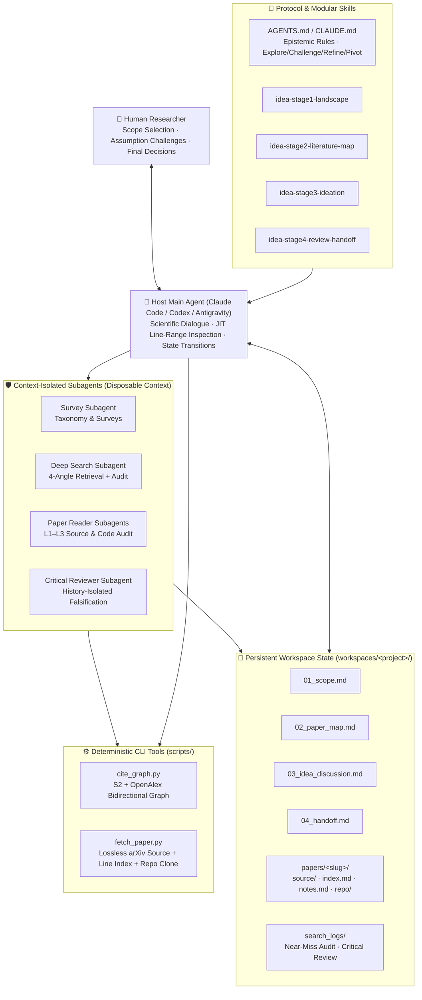

<p align="center">
  
</p>

<h3 align="center">
  <b>Don't Rebuild the Agent Runtime. Engineer How Coding Agents Conduct Scientific Research.</b>
</h3>

<p align="center">
  <a href="LICENSE"></a>
  <a href="https://www.python.org/"></a>
  <a href="pyproject.toml"></a>
  <a href="AGENTS.md"></a>
  <a href="tests/"></a>
</p>

<p align="center">
  <b>🇺🇸 English</b> · <a href="docs/README_CN.md">🇨🇳 简体中文</a>
</p>

<p align="center">
  <a href="#-why-researchflow">Why ResearchFlow?</a> ·
  <a href="#-architecture-research-workspace-protocol">Architecture</a> ·
  <a href="#-the-4-stage-ideation-workflow">4-Stage Workflow</a> ·
  <a href="#-quick-start">Quick Start</a> ·
  <a href="#-comparison-with-existing-systems">System Comparison</a> ·
  <a href="#️-cli-utilities">CLI Utilities</a> ·
  <a href="#️-roadmap">Roadmap</a>
</p>

---

## 🔥 News

- **[2026-11] `v0.2.0` Ideation Hardening Release** — Upgraded retrieval, anti-accretion ideation, and falsification review based on 4-domain backtest & postmortem diagnostics:
  - **Zero-Blind-Spot Retrieval ([`cite_graph.py`](scripts/cite_graph.py))**: Dual-provider S2 + OpenAlex merge with **3-tier temporal balancing** (latest preprints `C` + 1–2 year venue backbone `B_recent` + foundational classics `B_early`), **`--scan-bib`** zero-API 2-hop local `.bib` co-citation radar, **`--arxiv-recent`** zero-lag preprint stream, and **`--before-date`** temporal cutoffs for leak-free retrospective backtesting;
  - **Anti-Accretion Ideation ([`idea-stage3-ideation`](skills/idea-stage3-ideation/SKILL.md))**: Enforces a 1–2 tightly coupled primitive complexity cap, separates clean baseline bugfixes from core scientific claims, and triggers mandatory search-back whenever new sub-mechanisms are introduced;
  - **Coupled Falsification & Pilot-First Handoff ([`idea-stage4-review-handoff`](skills/idea-stage4-review-handoff/SKILL.md), [`04_handoff.md`](templates/04_handoff.md))**: Adds minimum-novel-core peeling, elementary-baseline dominance checks, end-to-end coupled state-machine Python simulations, and a **`Gate 0` (1–3h Pilot Falsification Test with Go/No-Go thresholds)** ahead of the full Main Table.
- **[2026-11] `v0.1.0` Initial Release** — Launching **ResearchFlow** with the **Phase I: Evidence-Grounded Ideation & Literature Mapping** workspace protocol.

---

## 🤔 Why ResearchFlow?

Most open-source "autonomous research" repositories promise *"One Command → One Full Paper."* In practice, when researchers actually use them on frontier AI topics, **ideation is where autonomous pipelines fail hardest**:

1. **Lossy Summarization Drift (`Abstract → Card → Synthesis → Idea`)**
   Compressing 800-character abstracts into knowledge cards and then into a single summary strips away exact mathematical formulations, implicit assumptions, hyperparameter confounders, and table footnotes. By the time the LLM proposes a hypothesis, it is reasoning over distorted second-hand slogans.
2. **Shooting the Arrow Before Drawing the Target**
   Many pipelines ask an LLM to invent a *"Novel Angle"*, *"Expected SOTA Gain"*, and *"Target Benchmark"* at Stage 1 from parametric priors **before reading a single real paper**, polluting downstream stages with hallucinated premises.
3. **Single-Line Echo Chambers & Missing Counter-Evidence**
   Keyword APIs sorted by citation count bury brand-new 0-citation competitors from the last 6–12 months and miss negative/reproduction studies or analogous mathematical mechanisms in adjacent subfields.
4. **Context Pollution & Sycophantic Drift**
   Dumping dozens of raw web searches and full PDFs into one chat window dilutes model attention, while sycophantic agents eagerly abandon a solid research direction whenever the human asks an exploratory *"what-if"* question.
5. **70,000+ Lines of Reinvented Agent Plumbing**
   Maintaining custom `while True: llm.chat()` loops, brittle regex parsers, and bespoke CLIs duplicates what modern coding agents (**Claude Code**, **Codex**, **Antigravity**) already do natively—and far more reliably.

### Our Core Thesis

> **ResearchFlow is not another standalone multi-agent framework. It is a *Research Workspace Protocol*.**
> The **Host Agent** provides execution, web search, and subagent isolation; **Skills** govern scientific epistemology and context hygiene; **Disk Artifacts** maintain the single auditable source of truth; and the **Human Researcher** owns every critical scientific decision.

---

## 🏛️ Architecture: Research Workspace Protocol



### Four Architectural Pillars

| Pillar | Mechanism in ResearchFlow | Problem Solved |
| :--- | :--- | :--- |
| **1. Epistemic 4-Way Split** | Every note and discussion explicitly separates `[Author Claim]`, `[Experimental Evidence]` (including uncontrolled confounders), `[Agent Inference]`, and `[Working Assumption]`. | Stops the agent from treating prior papers' introduction hype as proven scientific fact. |
| **2. Unmodified Ground Truth + JIT Indexing** | `fetch_paper.py` preserves `papers/<slug>/source/` (`main.tex`, `macros.tex`, `appendix.tex`) 100% untouched and builds a line-accurate `index.md`. The main agent loads only **40–120 lines** on demand. | Zero compression drift on equations/tables while keeping main chat context razor-thin. |
| **3. Subagent Isolation + Near-Miss Audit** | Heavy search and full-paper reading run inside disposable subagents. Search subagents must log a **Borderline Excluded (Top 5–10)** table in `search_logs/`. | Prevents raw search clutter in the main window while letting humans catch false-negative exclusions in 10 seconds. |
| **4. `Explore` / `Challenge` / `Refine` / `Pivot` + Blind Critic** | Distinguishes casual *"what-if"* exploration from root-assumption challenges, and runs a **history-isolated `Critical Reviewer`** before experimental handoff. | Prevents both sycophantic topic drift and confirmation-bias lock-in on flawed ideas. |

---

## 🔬 The 4-Stage Ideation Workflow

ResearchFlow structures early-stage research into four progressive stages, each governed by an on-demand skill under [`skills/`](skills/) and persisted to a clean Markdown state file:

### Stage 1 — Survey-First Landscape & Scope Lock ([`idea-stage1-landscape`](skills/idea-stage1-landscape/SKILL.md))
- **Dual Entry Modes**:
  - *Broad Topic Mode*: Dispatches a `Survey Subagent` to prioritize recent surveys, tutorials, and curated `Awesome-*` repositories (unpacking survey `.tex` taxonomies directly) plus web searches for developments from the last 6–12 months.
  - *Seed-Paper Fast-Track*: Already have 1–3 target papers? Initialize `01_scope.md` directly and jump straight to Stage 2.
- **Prerequisite-First Explanation**: Introduces core formal definitions and domain terminology accurately (no hand-wavy analogies) before mapping natural methodological branches, `A → B → C` evolutionary outlines, and realistic GPU/compute envelopes.
- **Output**: `01_scope.md` (strictly locks the **problem space and lineage branch**, never pre-committing to a premature algorithm).

### Stage 2 — 4-Angle Deep Search & Dynamic `L0–L3` Paper Map ([`idea-stage2-literature-map`](skills/idea-stage2-literature-map/SKILL.md))
Instead of staying trapped inside one citation clique, the `Deep Search Subagent` is required to retrieve across **four orthogonal angles** plus a local 2-hop `.bib` radar:
1. **Longitudinal + Zero-Lag Stream (`cite_graph.py`)**: S2 + OpenAlex 3-tier balanced citations (0-citation preprints `C` + recent venue backbone `B_recent` + foundational milestones `B_early`) paired with `--arxiv-recent` to catch 24–72h preprints before web indexers ingest them.
2. **Lateral**: Competing technical paradigms across `arXiv`, `OpenReview` (including Workshops), and `ACL/CVF` proceedings.
3. **Mechanistic & Dual Operators**: Analogous or inverse mathematical operators in adjacent subfields (e.g., 1-to-$N$ split relocation vs. $N$-to-1 merge absorption).
4. **Counter-Evidence (Mandatory)**: Negative results, reproduction failures, hyperparameter sensitivity studies, and critiques (`rethinking`, `revisiting`, `limitations`, `instability`).
5. **Local 2-Hop Co-Citation Radar (`--scan-bib`)**: Scans unpacked `papers/*/source/*.bib` files at zero API cost to surface unarchived papers frequently co-cited by frontier works.

Selected papers (typically 15–25) are read by parallel `Paper Reader Subagents` at dynamically upgradable depths:
- **`L0` Screened** → **`L1` Mechanism & Main Table** → **`L2` Full Text, Proofs & Appendix** (mandatory for close recent competitors) → **`L3` Official Codebase Audit** (`repo/` commit-pinned, verifying whether actual code matches paper equations or hides undocumented tricks).
- **Direct Baselines (strictly 1–3 papers)** must be solid, open-source, recognized, and recent.
- **Output**: Non-strawman `02_paper_map.md` + per-paper `papers/<slug>/notes.md` + `search_logs/stage2_search_audit.md`.

### Stage 3 — Parsimonious Source-Tethered Ideation ([`idea-stage3-ideation`](skills/idea-stage3-ideation/SKILL.md))
- Guided by three natural scientific lenses: **Literature Conflict & Confound Resolution**, **Direct-Baseline Code Surgery**, and **Optional Cross-Domain Mechanism Transfer**.
- **Anti-Accretion Complexity Budget**: Separates prior-repo bugfixes (`Baseline-Clean`) from core novelty, caps core mechanisms at **1–2 tightly coupled primitives** (no 4-module patchwork), and mandates an immediate **component search-back** (`Web + --scan-bib --keyword`) whenever a new sub-mechanism is introduced.
- Whenever equations, theorem conditions, or code modules are discussed, the host agent consults `papers/<slug>/index.md` and loads exact **40–120 line slices** from `source/` or `repo/`.
- Explicitly tracks **`Explore`**, **`Challenge`**, **`Refine`**, and **`Pivot`**.
- **Output**: `03_idea_discussion.md` (cleanly separating *Verified Facts*, *Working Assumptions*, *Clean-Baseline Prerequisites vs. Core Mechanism*, and *Ruled-Out / Pruned Modules*).

### Stage 4 — Coupled Falsification Review & Pilot-First Handoff ([`idea-stage4-review-handoff`](skills/idea-stage4-review-handoff/SKILL.md))
- **Blind Falsification Check**: Spawns a single history-isolated `Critical Reviewer Subagent` with **zero access to prior persuasion chat**, executing five sharp checks:
  1. *Minimum Novel Core & `L2` Theorem/Appendix Scoop Check* (`--arxiv-recent` + `--scan-bib` + OpenReview; strips borrowed wrappers to test whether the remaining core is genuinely novel rather than an `A+B+C` patchwork);
  2. *Premise, Proxy-Gap & Anti-Strawman Audit* against original `source/`, `repo/`, and `notes.md`;
  3. *Elementary Dominance & Confound Check* (verifying complex math does not degenerate into a 2-line elementary closed form like a hypergeometric test or simple damping, and checking iso-norm / iso-plasticity controls);
  4. *End-to-End Coupled State-Machine Simulation* (writing a Python script to test conditional gate selection bias, unobserved sparse-audit steps, competing thresholds, and analytical corner cases);
  5. *Statistical Exchangeability (`IID` vs. `OOD`) & Pilot Falsifiability*.
- **Two-Stage Experimental Handoff (`04_handoff.md`)**: Exports multi-dimensional readiness status, **`Gate 0` (a 1–3 hour Pilot Falsification Test with explicit Go/No-Go thresholds)**, and **literature-grounded Main Table settings** activated once `Gate 0` passes.

---

## ⚖️ Comparison with Existing Systems

| Dimension | AutoResearchClaw | autoresearch (Karpathy) | Agentic Scientist (AI-Scientist-v3) | AgentLaboratory | AI-Researcher | **ResearchFlow** |
| :--- | :--- | :--- | :--- | :--- | :--- | :--- |
| **Runtime Paradigm** | Custom 23-stage Python pipeline (~71k LOC) | Host coding agent + `program.md` | Headless coding agents in Docker + `SKILL.md` | Custom Python multi-role loop | Custom Docker agent framework | **Host coding agent + Workspace Protocol (~2.2k LOC)** |
| **Starting Point** | Broad topic string (writes unverified `goal.md` first) | Pre-built `prepare.py` + `train.py` + single metric | Pre-built `task.md` + `evaluate.py` harness | Topic + human notes | Seed `source_papers` + task spec | **Broad area OR 1–3 seed papers (zero prior hallucination)** |
| **Literature Retrieval** | Keyword APIs, truncated screening | None (pure empirical loop) | Post-hoc citation retrieval during paper writing | ArXiv summary loop (stops at N=5 papers) | Pre-supplied seed papers + code search | **Survey-first broad + 4-angle deep (incl. counter-evidence & balanced S2/OpenAlex graph)** |
| **Source Reading Fidelity** | 800-char truncated abstracts → 24 cards | N/A | Task files & local run memory | 50k-char PDF text with 3-step expiration | Page-up/down `.tex` browser + `Code Survey` | **Unmodified `.tex` `source/` + line-accurate `index.md` + JIT slice loading + `L0–L3` code audit** |
| **Epistemic Hygiene** | Single prose synthesis | Metric `val_bpb` keep/reset | Executable metric + `source_contains` rubrics | Postdoc/PhD free-form dialogue | Generate-5-then-select | **4-way split (Claim / Evidence / Inference / Assumption) + `Challenge` state** |
| **Anti-Confirmation Bias** | Non-blocking lexical Jaccard novelty score | Hard validation metric | Sealed final evaluator | Optional human retry | Self-selection prompt | **History-isolated `Critical Reviewer` subagent (scoop + confound audit)** |

---

## ⚡ Quick Start

### 1. Clone & Optional Setup

The CLI scripts use **100% Python 3.10+ standard library** and run out of the box with zero mandatory dependencies. Installing `pymupdf` is optional (used only as a fallback for PDF-only papers without arXiv LaTeX source):

```bash
git clone https://github.com/legend91019/ResearchFlow.git
cd ResearchFlow

# Optional: PDF fallback parser + pytest for development
pip install -e ".[pdf,dev]"
```

*(Optional)* Set environment variables for higher academic API rate limits:
```bash
export S2_API_KEY="your_semantic_scholar_key"   # Optional: auto-falls back to OpenAlex on HTTP 429
export OPENALEX_EMAIL="you@university.edu"      # Optional: joins OpenAlex polite pool
```

### 2. Open in Your Host Coding Agent & Start Chatting

Open the `ResearchFlow/` directory in **Claude Code**, **Codex**, or **Antigravity**. The host automatically reads [`AGENTS.md`](AGENTS.md) / [`CLAUDE.md`](CLAUDE.md) and routes to the active stage skill.

#### Option A: Start from a Broad Research Area (Stages 1 → 4)
```text
I want to explore continual learning for LLMs. My compute budget is a single 24GB GPU.
Please create workspaces/cl_peft and start Stage 1 landscape research.
```

#### Option B: Start from 1–3 Seed Papers (Fast-Track to Stage 2)
```text
I want to investigate orthogonal subspace methods in continual PEFT, starting from O-LoRA (arXiv:2310.14152)
and InfLoRA (arXiv:2404.00228). Compute limit: single RTX 4090.
Initialize workspaces/ortho_cl and jump directly into Stage 2 4-angle deep search and paper mapping.
```

#### Resuming or Clearing Context Between Stages
Because every milestone is persisted cleanly to `workspaces/<project>/`, you can run `/compact` or open a brand-new chat window at any stage boundary:
```text
Read workspaces/ortho_cl/01_scope.md and workspaces/ortho_cl/02_paper_map.md,
and let's continue Stage 3 ideation.
```

<details>
<summary>📂 <b>Click to inspect a generated workspace directory & <code>index.md</code> example</b></summary>

```text
workspaces/ortho_cl/
├── 01_scope.md                         # Taxonomy, compute envelope, locked A→B→C branch
├── 02_paper_map.md                     # Temporal lineage, mechanism/confound matrix, main-table consensus
├── 03_idea_discussion.md               # Verified facts vs. working assumptions, candidate spec, ruled-out ideas
├── 04_handoff.md                       # Finalized method coordinates & main-table experimental setup
├── search_logs/
│   ├── stage2_search_audit.md          # 4-angle queries + Borderline Excluded (Top 5-10) near-miss audit
│   └── critical_review.md              # History-isolated 5-question falsification & scoop report
└── papers/
    └── 2023_olora/
        ├── source/                     # Unmodified original arXiv .tex, macros.tex, tables/, .bib
        ├── repo/                       # Shallow-cloned official GitHub repo (commit SHA recorded)
        ├── metadata.json               # Title, authors, year, SHA-256 digests, pinned repo commit
        ├── index.md                    # Exact file:Lstart-Lend map for macros, sections, tables, equations
        └── notes.md                    # 4-way epistemic reading dossier (L1 / L2 / L3)
```

Sample excerpt from an auto-generated `papers/<slug>/index.md`:
```markdown
## 1. Custom Macros & Notation Definitions (Read Before Interpreting Equations)
- `source/macros.tex:L2-L38` (19 definitions, e.g. `\proj`, `\subspace`, `\orthloss`)

## 2. Section & Appendix Line Index (Use Line Ranges for JIT Reading)
- **Introduction** — `source/sections/intro.tex:L1-L74`
- **Proposed Method** — `source/sections/method.tex:L1-L18`
  - **Orthogonal Subspace Constraint** — `source/sections/method.tex:L19-L96`
- **Appendix** — `source/appendix.tex:L1-L142`

## 3. Experimental & Summary Tables
- `source/tables/main_results.tex:L1-L34` (`tab:main`): Main comparison across 15 continual learning benchmarks.
```

</details>

---

## 🛠️ CLI Utilities

Both helper scripts under [`scripts/`](scripts/) can also be run standalone from any terminal:

### 1. `scripts/cite_graph.py` — 3-Tier Citation Graph, Local `.bib` Radar & Zero-Lag arXiv Stream
Merges **Semantic Scholar** and **OpenAlex** with 3-tier temporal balancing (latest preprints `C` + 1–2 year venue backbone `B_recent` + foundational classics `B_early`) and optional `--before-date YYYY-MM-DD` cutoffs for retrospective backtesting. Also provides `--scan-bib` (zero-API 2-hop co-citation scan over downloaded `.bib` files) and `--arxiv-recent` (direct `export.arxiv.org` preprint stream).

```bash
# 1) Bidirectional 3-tier citation graph
python scripts/cite_graph.py 2310.14152 \
  --direction both \
  --limit 40 \
  --with-abstracts \
  --out workspaces/demo/search_logs/olora_graph.md \
  --json-out workspaces/demo/search_logs/olora_graph.json

# 2) Zero-API 2-hop co-citation scan across local papers/*/source/*.bib
python scripts/cite_graph.py --scan-bib workspaces/demo --keyword "subspace|spectral" --limit 25

# 3) Zero-lag arXiv stream for the last 30 days
python scripts/cite_graph.py --arxiv-recent "continual learning lora" --categories "cs.LG,cs.CL" --days 30
```

### 2. `scripts/fetch_paper.py` — Lossless Source Unpacker & Line-Range Indexer
Downloads arXiv e-print `.tar.gz` / `.gz` archives (with path-traversal and SSRF guards), keeps `source/` byte-for-byte untouched, resolves multi-file `\input` / `\include` trees, indexes custom macros, sections, tables, theorems, and labeled equations with exact `file:Lstart-Lend` coordinates, and optionally shallow-clones the official repository.

```bash
python scripts/fetch_paper.py \
  --arxiv 2310.06762 \
  --workspace workspaces/demo \
  --slug 2023_olora \
  --repo https://github.com/cmnfriend/O-LoRA \
  --with-pdf \
  --role "Direct Baseline"
```

---

## 📂 Repository Structure

```text
ResearchFlow/
├── AGENTS.md                        # Authoritative Research Workspace Protocol (Codex / Antigravity / OpenCode)
├── CLAUDE.md                        # Claude Code entrypoint referencing AGENTS.md
├── docs/
│   ├── README_CN.md                 # Simplified Chinese documentation
│   └── assets/banner.svg            # Vector architecture banner
├── skills/                          # Stage-scoped skills loaded on demand
│   ├── idea-stage1-landscape/       # Broad survey-first discovery & taxonomy scoping
│   ├── idea-stage2-literature-map/  # 4-angle deep search, near-miss audit & L0–L3 paper mapping
│   ├── idea-stage3-ideation/        # JIT source/code slice inspection & assumption-aware ideation
│   └── idea-stage4-review-handoff/  # Blind critical review & consensus main-table handoff
├── scripts/                         # Zero-dependency deterministic helper CLIs
│   ├── cite_graph.py                # S2 + OpenAlex bidirectional citation graph
│   └── fetch_paper.py               # Unmodified arXiv/PDF fetcher, LaTeX indexer & repo cloner
├── templates/                       # Clean Markdown schemas for 01–04 state files, notes & audits
├── tests/                           # Unit & protocol integrity test suite
└── workspaces/                      # Local per-topic research workspaces (git-ignored by default)
```

---

## 🗺️ Roadmap

ResearchFlow is being developed progressively across the four stages of the AI research lifecycle:

- [x] **Phase I — Evidence-Grounded Ideation & Literature Mapping (`v0.1`–`v0.2`)**
  - Survey-first taxonomy scoping, 3-tier citation graph + `.bib` co-citation radar + zero-lag arXiv stream, anti-accretion ideation, coupled numerical falsification review, and `Gate 0` pilot-first handoff.
- [ ] **Phase II — Consensus Experimental & Diagnostic Protocol Design (`v0.3`)**
  - Translating `04_handoff.md` and `02_paper_map.md` into `Gate 0` pilot runners, confound-controlled experimental matrices, ablation designs, and pre-flight verification checks.
- [ ] **Phase III — Budget-Aware Execution & Fault-Tolerant Diagnostics (`v0.4`)**
  - Deterministic training/evaluation harnesses, compute budget guards, checkpointed queues, and implementation fidelity audits.
- [ ] **Phase IV — Result Analysis, Scientific Visualization & Evidence-Bound Writing (`v0.5`)**
  - Counterfactual analysis, publication-grade plotting, and manuscript generation strictly bound to verified metrics and primary sources.

---

## 🧪 Running Tests

```bash
pytest -v
```

---

## 📜 Acknowledgements & References

ResearchFlow's design is informed by hands-on analysis and critical comparison of open-source autonomous research systems, including [AutoResearchClaw](https://github.com/aiming-lab/AutoResearchClaw), [autoresearch](https://github.com/karpathy/autoresearch), [The Agentic Scientist (AI-Scientist-v3)](https://github.com/SakanaAI/AI-Scientist-v3), [AgentLaboratory](https://github.com/SamuelSchmidgall/AgentLaboratory), and [AI-Researcher](https://github.com/HKUDS/AI-Researcher).

## 📄 License

Released under the [MIT License](LICENSE).
