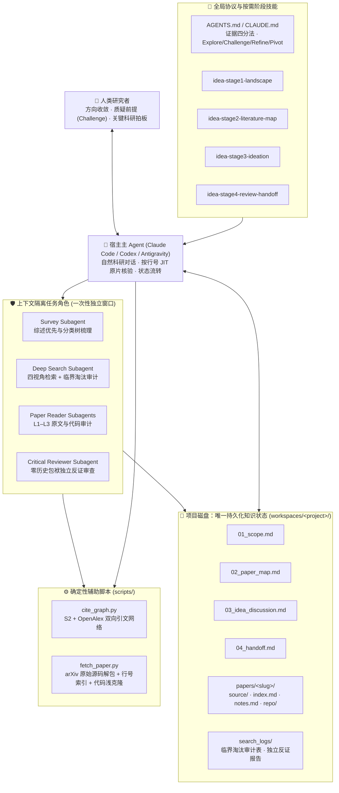

<p align="center">
  
</p>

<h3 align="center">
  <b>不重复造简陋的 Agent 运行时 —— 专注于设计编码智能体做科研的证据协议、信息组织与决策机制。</b>
</h3>

<p align="center">
  <a href="../LICENSE"></a>
  <a href="https://www.python.org/"></a>
  <a href="../pyproject.toml"></a>
  <a href="../AGENTS.md"></a>
  <a href="../tests/"></a>
</p>

<p align="center">
  <a href="../README.md">🇺🇸 English</a> · <b>🇨🇳 简体中文</b>
</p>

<p align="center">
  <a href="#-为什么做-researchflow">为什么做 ResearchFlow？</a> ·
  <a href="#️-核心架构科研工作空间协议">核心架构</a> ·
  <a href="#-idea-研究四阶段工作流">四阶段工作流</a> ·
  <a href="#-快速开始">快速开始</a> ·
  <a href="#️-与现有开源系统的对比">系统对比</a> ·
  <a href="#️-确定性命令行工具">命令行工具</a> ·
  <a href="#️-演进路线图">路线图</a>
</p>

---

## 🔥 最新动态

- **[2026-11] `v0.3.0` 实验先导、设计与保真执行版发布** — 将 ResearchFlow 从前期构思完整延伸至可审计的实验闭环（**阶段 5 → 阶段 7B**）：
  - **算力前置确认的 `Gate 0` 先导实证（[`exp-stage5-pilot`](../skills/exp-stage5-pilot/SKILL.md)）**：开跑前强制确认目标算力（严禁擅跑宿主本机），通过零依赖 [`remote_gpu.py`](../scripts/remote_gpu.py) 完成 1–3 小时受控先导验证、记录真实 `ms/step` 与显存基线，并锁定最终极简方法（`05_pilot_report.md`）；
  - **回读文献惯例的完整实验与数据图表蓝图（[`exp-stage6-design`](../skills/exp-stage6-design/SKILL.md)）**：强制回读 `02_paper_map.md` §5、`04_handoff.md` §4–5 与 `papers/*/notes.md` 提炼子领域顶会实验惯例，显式拆分“独立跑卡批次”与“零算力派生切片”（一次运行、多维出图），输出双轨兜底图表说明书 [`figures/figure_plan.md`](../templates/figure_plan.md) 与真机折算卡时账单，停顿与研究者协商算力与种子范围（`06_exp_plan.md`）；
  - **条件等价编码预检与多卡保真审计执行（[`exp-stage7a-coding`](../skills/exp-stage7a-coding/SKILL.md)、[`exp-stage7b-execution`](../skills/exp-stage7b-execution/SKILL.md)、[`run_matrix.py`](../scripts/run_matrix.py)、[`audit_exp.py`](../scripts/audit_exp.py)）**：落地官方基线外科复用、三层参数公平协议、显存条件等价核验、机制感知最小触发测试（`test_claims.py`）、10 秒最坏条件显存压测、一机多卡只增账本队列（防新旧 Bug 版本混算）及确定性覆盖率/溯源/图表反硬编码审计（`07_exp_results.md`）。
- **[2026-11] `v0.2.0` Idea 阶段深度加固版发布** — 基于跨 4 个子领域的时序回测与根因取证复盘，全面升级检索召回、极简构思预算与级联反证机制：
  - **零盲区文献雷达（[`cite_graph.py`](../scripts/cite_graph.py)）**：修复截断前短路问题并升级为 S2 + OpenAlex **三桶时间均衡召回**（最新预印本 `C` + 近 1–2 年顶会中坚 `B_recent` + 奠基经典 `B_early`），新增 **`--scan-bib` 本地 `.bib` 二跳共引雷达**（零 API 开销抓出高频漏网文献）、**`--arxiv-recent` 零延迟预印本流**（绕过 48 小时索引滞后）及 `--before-date` 严格回测时间锁；
  - **奥卡姆反拼盘构思约束（[`idea-stage3-ideation`](../skills/idea-stage3-ideation/SKILL.md)）**：强制剥离“基线修 Bug”与“核心科学贡献”，严控核心机制在 1–2 个紧耦合原语内，且每引入新算子强制触发回跳查重；
  - **级联数值反证与 `Gate 0` 先导优先交接（[`idea-stage4-review-handoff`](../skills/idea-stage4-review-handoff/SKILL.md)、[`04_handoff.md`](../templates/04_handoff.md)）**：升级最小创新核剥离、初等闭式方法占优检验与跨模块级联 Python 状态机仿真，并在全量主实验前增设 **单卡 1–3 小时 `Gate 0` 生死先导实验（附量化 Go/No-Go 门槛）**。
- **[2026-11] `v0.1.0` 正式发布** — 推出 **ResearchFlow** 第一阶段（**实证型 Idea 讨论与文献建图协议**）。

---

## 🤔 为什么做 ResearchFlow？

市面上不少开源 Auto-Research 系统主打*“输入一句话，全自动产出一篇顶会论文”*。但在真实前沿 AI 课题上深度体验后就会发现，**Idea 构思恰恰是现有自动化工具与人类研究者差距最大、最容易产出废品的环节**：

1. **逐层摘要导致的信息漂移（`摘要 → 知识卡片 → 综述 → 假设`）**
   把截断到 800 字的摘要压成卡片、再把前 24 张卡片压成一篇综述，原论文的精确数学定义、隐式成立条件、未对齐的超参混杂变量和表格脚注早已丢失殆尽。模型最终只是在二手口号上排列组合。
2. **先射箭后画靶（未读文献先盲猜创新点）**
   不少流水线在第 1 步还没检索任何真实论文时，就让大模型凭先验概率编造 `Novel Angle`、钦定 `Benchmark` 甚至预估涨点幅度，导致整条下游链路建立在幻觉前提之上。
3. **单一引文圈回音室与反证缺失**
   单纯依赖关键词 API 并按引用数排序截断，不仅会把近 6–12 个月刚挂出来 0 引用的直接撞车论文挤出视野，还会漏掉负面复现研究与相邻子领域的同构数学机制分析。
4. **上下文涣散与讨好型跑偏（Sycophancy Drift）**
   在同一聊天窗口里连刷几十次搜索和长文阅读会严重稀释模型注意力；同时大模型极易“顺杆爬”——人类随口追问一句旁支想法，模型立刻推翻原本扎实的主线去迎合新词。
5. **7 万行重复造轮子的脆弱工程壳子**
   用几万行自定义 Python 循环、正则解析和简陋 CLI 去重造 Agent 运行时，既挤占上下文又充满静默降级 Bug——而现代原生编码宿主（**Claude Code**、**Codex**、**Antigravity**）本身就已经具备极强的搜索、文件操作与子智能体隔离能力。

### 我们的核心主张

> **ResearchFlow 不是另一套大包大揽的多智能体后台框架，而是一套 *科研工作空间协议（Research Workspace Protocol）*。**
> **宿主 Agent** 负责执行、联网与子智能体隔离；**Skill 规范** 负责科研认识论与上下文卫生；**项目磁盘文件** 负责唯一可审计的长期知识状态；**人类研究者** 掌握每一次关键科学判断。

---

## 🏛️ 核心架构：科研工作空间协议



### 四大核心机制设计

| 核心支柱 | ResearchFlow 具体机制 | 解决的真实痛点 |
| :--- | :--- | :--- |
| **1. 证据四分法** | 一切论文档案与讨论文档强制拆开标注：`[作者声称]`、`[实验实证]`（含未控制的混杂变量）、`[模型推断]`、`[未验证假设]`。 | 彻底杜绝把前人论文 Introduction 里的包装口号当成已证实的科学事实。 |
| **2. 原始材料零删改 + JIT 行号挂载** | `fetch_paper.py` 将 `papers/<slug>/source/`（含 `macros.tex`、`appendix.tex`）原封不动保留并生成行号索引 `index.md`；主窗口推演时每次只按行号挂载 **40–120 行**原片。 | 公式与表格细节零压缩失真，同时保证主对话窗口上下文极度干净。 |
| **3. 子智能体隔离 + 临界淘汰审计** | 脏搜索与批量长文阅读全部交由一次性 Subagent 执行；搜索子智能体必须在 `search_logs/` 输出 **临界淘汰名单（Borderline Excluded Top 5–10）**。 | 隔离几万字检索噪音，同时让研究者花 10 秒扫视即可防止子智能体误杀关键论文。 |
| **4. 四态讨论控制 + 独立盲审反证** | 严格区分 `Explore`（随口探询）与 `Challenge`（质疑根基假设），并在定稿移交前拉起**零历史包袱的 `Critical Reviewer`** 做五问反证。 | 既防讨好式跑偏，又防止主 Agent 顺着既有偏好替错误假设护短（确认偏误）。 |

---

## 🔬 Idea 研究四阶段工作流

ResearchFlow 将科研前期的构思过程划分为四个递进阶段，每个阶段仅按需加载对应的单个 [`SKILL.md`](../skills/)，并通过磁盘状态文件无缝接力：

### 阶段 1 — 综述优先广搜与细分分支锁定（[`idea-stage1-landscape`](../skills/idea-stage1-landscape/SKILL.md)）
- **支持双起点入口**：
  - *宽泛方向模式*：派发 `Survey Subagent` 优先检索近 2–3 年高质量综述（直接拉取 `.tex` 阅读其分类框架）、Tutorial 与 GitHub `Awesome-*` 仓库，并用网页搜索补齐近 6–12 个月新动向。
  - *种子论文直入模式*：若手里已有 1–3 篇目标论文，直接核对范围写入 `01_scope.md`，跳过泛搜直入阶段 2。
- **先铺垫精确定义，再摆学术分类树（Taxonomy）**：拒绝生硬失真的大白话比喻，先用简练准确的学术语言交代核心概念与问题设定，再梳理客观存在的技术流派、`A → B → C` 演进雏形与算力门槛。
- **阶段产物**：`01_scope.md`（锁定**问题空间与演化分支**，绝不在此刻预设具体新算法）。

### 阶段 2 — 四视角深搜与动态 `L0–L3` 论文地图（[`idea-stage2-literature-map`](../skills/idea-stage2-literature-map/SKILL.md)）
为避免陷入单一引文小圈子，`Deep Search Subagent` 必须覆盖**四个正交搜索视角**与本地二跳共引扫描：
1. **纵向演化 + 零延迟流（`cite_graph.py`）**：S2 + OpenAlex **三桶时间均衡施引**（零引用最新预印本 `C` + 近 1–2 年顶会中坚 `B_recent` + 奠基高引 `B_early`），配合 `--arxiv-recent` 直拉近 30 天预印本，消除搜索引擎索引滞后。
2. **横向路线与多渠道搜索**：覆盖 `arXiv`、`OpenReview`（含 Workshop）与 `ACL / CVF` 论文集，并列同义动作词防漏检。
3. **相邻与对偶机制搜索**：剥离业务包装词，同时检索正向与逆向对偶数学算子（如分裂重定位 $\leftrightarrow$ 合并吸收）。
4. **反证与失效搜索（必做）**：专门检索负面结论、复现质疑、超参敏感性与失效边界分析（`rethinking`、`revisiting`、`limitations`、`instability`）。
5. **本地 `.bib` 二跳共引雷达（`--scan-bib`）**：零 API 开销扫描已解包论文的 `.bib`，自动揪出被多篇前沿论文共同引用却尚未入库的关键文献。

对入选的 15–25 篇文献执行可动态升档的分级阅读（`Paper Reader Subagent`）：
- **`L0` 相关性筛查** → **`L1` 核心机制与主表** → **`L2` 全文推导与附录深读**（高威胁近邻强制直通 `L2` 核查附录定理与控制表） → **`L3` 官方代码仓实现审计**。
- **直接基线（`Direct Baseline`，严控 1–3 篇）** 必须满足四条硬标准：方法经得起推敲、有官方开源代码、在领域内有认可度、发表时间较新。
- **阶段产物**：反稻草人化 `02_paper_map.md` + 单篇档案 `papers/<slug>/notes.md` + 防漏筛记录 `search_logs/stage2_search_audit.md`。

### 阶段 3 — 极简复杂度预算与受约束构思（[`idea-stage3-ideation`](../skills/idea-stage3-ideation/SKILL.md)）
- 通过三类科研思考透镜引导推理：**文献冲突与混杂破局**、**直接基线代码级手术**、以及**按需开启的跨子领域机制迁移**。
- **奥卡姆反拼盘预算**：将前人代码 Bug 修复单列为公平强基线（`Baseline-Clean`），严控核心机制改动在 **1–2 个紧耦合原语**以内（严禁“发现 4 个缺陷就焊 4 个补丁模块”）；一旦引入 Stage 2 未搜过的新子算子，强制触发回跳检索（`Web + --scan-bib --keyword`）。
- 凡讨论具体公式修改、定理前提或代码手术，必须查 `papers/<slug>/index.md` 按起止行号精准加载 `source/` 或 `repo/` 中对应的 **40–120 行原片**。
- 严格执行 **`Explore` / `Challenge` / `Refine` / `Pivot`** 规则。
- **阶段产物**：`03_idea_discussion.md`（清晰分离*已验证事实*、*工作假设*、*基线纠偏前提 vs. 单一核心机制*与*已排除/砍除模块归档*）。

### 阶段 4 — 级联数值反证与 `Gate 0` 先导优先交接（[`idea-stage4-review-handoff`](../skills/idea-stage4-review-handoff/SKILL.md)）
- **零历史包袱五把手术刀反证**：不堆砌多个审稿 Agent，也不做算命打分，由单个完全隔离妥协历史的 `Critical Reviewer Subagent` 独立执行：
  1. *最小创新核剥离与近邻 `L2` 附录查重*（剥去通用校准壳与基线修 Bug 后，检验核心机制能否独立成文、是否可由 `A+B` 组合替代）；
  2. *核心前提、代理断层与反稻草人核查*；
  3. *奥卡姆初等基线占优与混杂检验*（排查复杂数学形式是否退化为超几何检验、对数似然比或常数阻尼等 2 行初等式，检验等范数/等可塑性控制）；
  4. *端到端级联状态机 Python 数值仿真*（联合模拟门控选择偏差、稀疏抽检缺失步、上下界抢跑竞争与解析极限反例）；
  5. *统计可交换性（真 `IID` vs. `OOD`）与先导可证伪性核查*。
- **两级漏斗实验接力包（`04_handoff.md`）**：如实输出多维就绪度评估，先给出 **单卡 1–3 小时可跑完的 `Gate 0` 最小生死先导实验（带量化 Go/No-Go 门槛）**，再给出 `Gate 0` 通过后启用的**文献共识主实验（Main Table）设置**。

---

## 🧪 实验先导、设计与保真执行工作流（阶段 5 → 7B）

定稿 `04_handoff.md` 后，ResearchFlow 严格区分 **Agent 的工程自主权**（远程同步、性能剖析、故障恢复、确定性出图）与 **人类研究者的科学决策权**（算力授权、种子/底座范围协商、真实正负结果去留）：

### 阶段 5 — `Gate 0` 先导实证与方法定型（[`exp-stage5-pilot`](../skills/exp-stage5-pilot/SKILL.md)）
- **强制算力前置确认**：开跑前先确认远程 GPU/SSH 资源，绝不擅自占用宿主本机 CPU/GPU。
- 通过 [`remote_gpu.py`](../scripts/remote_gpu.py) 执行单元测试、15 秒真机冒烟测速（实测 `steady_ms_per_step` 与 `peak_vram_gb`）及 1–3 小时受控对照，在 `05_pilot_report.md` 锁定 `GO` / `SIMPLIFY` / `PIVOT` 裁决。

### 阶段 6 — 子领域惯例驱动的实验与数据图表设计（[`exp-stage6-design`](../skills/exp-stage6-design/SKILL.md)）
- **强制回读前序共识**：从 `02_paper_map.md` §5、`04_handoff.md` §4–5 与近邻 `papers/<slug>/notes.md` 提炼同行 Benchmark、Baseline 规模、常用种子惯例（如 `1 seed` vs. `3 seeds`）与超参公平协议（`Paper-Native` / `Equal-Tuning`）。
- **一次运行、多维切片 + 图表双轨说明书**：拆分需跑卡批次与零算力派生切片，输出实验数据图表说明书 `figures/figure_plan.md` 与基于 `Gate 0` 实测吞吐的卡时账单（`06_exp_plan.md`），停顿与人类协商算力并锁定 `exp_manifest.json`（架构框图留待论文写作阶段）。

### 阶段 7A — 实验编码、条件等价适配与三重预检（[`exp-stage7a-coding`](../skills/exp-stage7a-coding/SKILL.md)）
- 外科手术式复用 `papers/<slug>/repo/` 官方代码并哈希锁定 `eval_harness.py`；执行显存**条件等价核验**（严查整除性、Token 归一化与 `optimizer.step()` 触发边界）；跑通**机制最小触发测试 `test_claims.py`**、**独立 `Code-to-Claim` 代码盲审**与 **10 秒最坏条件显存压测**。

### 阶段 7B — 多卡/远程断点执行、分级自愈与保真审计（[`exp-stage7b-execution`](../skills/exp-stage7b-execution/SKILL.md)）
- 由 [`run_matrix.py`](../scripts/run_matrix.py) + [`remote_gpu.py`](../scripts/remote_gpu.py) 驱动一机多卡负载均衡与只增账本 `ledger.jsonl`（修公共 Bug 时用 `invalidate` 防止新旧版本混算），直接从原始结果渲染 `.pdf`/`.png` 实验图表，并通过 [`audit_exp.py`](../scripts/audit_exp.py) 全量审计后交付 `07_exp_results.md`。

---

## ⚖️ 与现有开源系统的对比

| 对比维度 | AutoResearchClaw | autoresearch (Karpathy) | Agentic Scientist (AI-Scientist-v3) | AgentLaboratory | AI-Researcher | **ResearchFlow** |
| :--- | :--- | :--- | :--- | :--- | :--- | :--- |
| **运行载体架构** | 自建 23 阶段重型 Python 管线（~7.1 万行） | 宿主编码 Agent + `program.md` | Docker 内置 Headless 编码 Agent + `SKILL.md` | 自建 Python 多角色对话循环 | 自建 Docker 多智能体框架 | **原生编码宿主 + 科研工作空间协议（~2,200 行）** |
| **任务输入起点** | 宽泛主题词（第 1 步先盲写未核实的 `goal.md`） | 人类预置 `prepare.py` + `train.py` + 单一指标 | 预置 `task.md` + 只读评分器 `evaluate.py` | 主题描述 + 人工备注 | 预给 `source_papers` + 任务书 | **宽泛大方向 或 1–3 篇种子论文（严禁前置脑补）** |
| **文献检索策略** | 关键词 API 抓取 + 字符硬截断初筛 | 无文献检索（纯实验迭代） | 写论文阶段后置检索 | ArXiv 摘要循环（默认收满 5 篇即停） | 依赖给定种子文献 + 代码搜索 | **综述优先广搜 + 四视角深搜（含反证检索与双源均衡引文网）** |
| **文献阅读保真度** | 800 字截断摘要 → 前 24 张卡片拼综述 | 不适用 | 读任务文件与本地实验记忆 | 5 万字 PDF 文本（3 步自动过期清退） | 翻页浏览 `.tex` + `Code Survey` | **`source/` 原始 `.tex` 零修改保留 + 行号索引 `index.md` + JIT 原片挂载 + `L0–L3` 代码审计** |
| **认知防漂移机制** | 单篇 Markdown 综述生成 | `val_bpb` 指标优胜劣汰 | 指标门槛 + `source_contains` 静态校验 | 博后与博士生自由对话 | 发散生成 5 个方案再自选 | **证据四分法（声称/实证/推断/假设）+ `Challenge` 假设质询** |
| **防确认偏误机制** | 非阻断词面 Jaccard 新颖性分数 | 真实训练指标硬验证 | 密封终测集评测 | 可选人工打回重试 | 模型自我择优提示词 | **历史隔离的 `Critical Reviewer` 子智能体（跨术语查重 + 混杂归因拷问）** |

---

## ⚡ 快速开始

### 1. 克隆仓库与可选依赖

仓库内的辅助脚本**核心功能 100% 基于 Python 3.10+ 标准库**，无需安装任何第三方包即可运行。仅当你需要解析没有 LaTeX 源码的纯 PDF 论文时，可选安装 `pymupdf`：

```bash
git clone https://github.com/legend91019/ResearchFlow.git
cd ResearchFlow

# 可选：安装纯 PDF 回退解析支持与 pytest 测试工具
pip install -e ".[pdf,dev]"
```

*(可选)* 配置学术 API 环境变量以获得更高速率配额：
```bash
export S2_API_KEY="你的_Semantic_Scholar_Key"   # 可选：无 Key 遇 HTTP 429 限流时会自动无缝切换 OpenAlex
export OPENALEX_EMAIL="you@university.edu"      # 可选：加入 OpenAlex 礼貌池提升免费并发额度
```

### 2. 在宿主编码 Agent 中打开并直接对话

使用 **Claude Code**、**Codex** 或 **Antigravity** 打开 `ResearchFlow/` 根目录，宿主会自动读取 [`AGENTS.md`](../AGENTS.md) / [`CLAUDE.md`](../CLAUDE.md) 并按阶段加载对应技能。

#### 方式 A：从宽泛大方向开始（完整走阶段 1 → 4）
```text
我想研究大模型持续学习（Continual Learning）方向，手头算力是单张 24GB 显卡。
请创建工作空间 workspaces/cl_peft，开始阶段 1 方向广搜与分类树梳理。
```

#### 方式 B：手里已有 1–3 篇种子论文（跳过广搜，直入阶段 2）
```text
我想围绕 O-LoRA (arXiv:2310.14152) 和 InfLoRA (arXiv:2404.00228) 所在的持续 PEFT 正交子空间路线找改进点，
算力上限单张 RTX 4090。请初始化 workspaces/ortho_cl，直接进入阶段 2 四视角深搜与论文建图。
```

#### 跨阶段清理上下文与断点续聊
由于每个阶段的事实、工作假设与废案归档都结构化保存在 `workspaces/<project>/` 下，每走完一个阶段（或对话超过 15–20 轮时），你可以随时执行 `/compact` 或直接新开一个干净会话无缝续接：
```text
请读取 workspaces/ortho_cl/01_scope.md 和 workspaces/ortho_cl/02_paper_map.md，
我们继续进行阶段 3 的 Idea 推演。
```

<details>
<summary>📂 <b>点击查看课题工作区产物目录与自动生成的 <code>index.md</code> 示例</b></summary>

```text
workspaces/ortho_cl/
├── 01_scope.md                         # 学术分类树、算力边界、锁定的 A→B→C 细分分支与种子论文
├── 02_paper_map.md                     # 时序演进脉络、机制/混杂控制对比矩阵、主实验共识统计
├── 03_idea_discussion.md               # 已验证事实 vs. 工作假设、候选方案规格、已排除废案及原因
├── 04_handoff.md                       # 定稿公式/代码改动坐标与对齐近期文献的主实验接力包
├── search_logs/
│   ├── stage2_search_audit.md          # 四视角检索轨迹 + 临界淘汰名单 (Borderline Excluded Top 5-10)
│   └── critical_review.md              # 历史隔离的五问反证与跨术语撞车审查报告
└── papers/
    └── 2023_olora/
        ├── source/                     # 一字未改的原始 arXiv .tex 源码、macros.tex、tables/、.bib
        ├── repo/                       # 浅克隆的官方 GitHub 代码库（锁定 commit SHA）
        ├── metadata.json               # 标题、作者、年份、原始包 SHA-256 校验值、仓库 commit
        ├── index.md                    # 精确到 file:Lstart-Lend 的宏定义、章节、实验表、公式索引
        └── notes.md                    # 证据四分法阅读档案（支持 L1 → L2 → L3 动态升档）
```

自动生成的 `papers/<slug>/index.md` 片段示例：
```markdown
## 1. Custom Macros & Notation Definitions (Read Before Interpreting Equations)
- `source/macros.tex:L2-L38` (19 definitions, e.g. `\proj`, `\subspace`, `\orthloss`)

## 2. Section & Appendix Line Index (Use Line Ranges for JIT Reading)
- **Introduction** — `source/sections/intro.tex:L1-L74`
- **Proposed Method** — `source/sections/method.tex:L1-L18`
  - **Orthogonal Subspace Constraint** — `source/sections/method.tex:L19-L96`
- **Appendix** — `source/appendix.tex:L1-L142`

## 3. Experimental & Summary Tables
- `source/tables/main_results.tex:L1-L34` (`tab:main`): Main comparison across 15 continual learning benchmarks.
```

</details>

---

## 🛠️ 确定性命令行工具

[`scripts/`](../scripts/) 下的两个脚本也可在终端中独立调用：

### 1. `scripts/cite_graph.py` —— 三桶时间均衡引文网、本地 `.bib` 二跳雷达与零延迟 arXiv 流
联合查询 **Semantic Scholar** 与 **OpenAlex** 并跨源合并去重，施引采用**最新预印本 `C` + 近 1–2 年顶会中坚 `B_recent` + 经典高引 `B_early` 三桶均衡**（支持 `--before-date YYYY-MM-DD` 历史回测防穿越）；同时内置 `--scan-bib`（零 API 扫描本地 `.bib` 二跳高频共引文献）与 `--arxiv-recent`（直连 `export.arxiv.org` 拉取零延迟新预印本）。

```bash
# 1) 双向三桶均衡引文网查询
python scripts/cite_graph.py 2310.14152 \
  --direction both \
  --limit 40 \
  --with-abstracts \
  --out workspaces/demo/search_logs/olora_graph.md \
  --json-out workspaces/demo/search_logs/olora_graph.json

# 2) 零 API 开销扫描本地 papers/*/source/*.bib 中的二跳高频漏网文献
python scripts/cite_graph.py --scan-bib workspaces/demo --keyword "subspace|spectral" --limit 25

# 3) 直连 arXiv API 拉取近 30 天零延迟新预印本
python scripts/cite_graph.py --arxiv-recent "continual learning lora" --categories "cs.LG,cs.CL" --days 30
```

### 2. `scripts/fetch_paper.py` —— 原始源码无损解包与行号索引器
下载 arXiv e-print `.tar.gz` / `.gz` 源码包（内置路径穿越与 SSRF 防护），**保证 `source/` 下所有原始文件零删改**；自动解析 `\input` / `\include` 多文件引用拓扑，提取自定义宏文件、章节层级、实验表格、定理与带标签公式的精确 `file:Lstart-Lend` 行号区间，并支持浅克隆官方开源代码库。

```bash
python scripts/fetch_paper.py \
  --arxiv 2310.06762 \
  --workspace workspaces/demo \
  --slug 2023_olora \
  --repo https://github.com/cmnfriend/O-LoRA \
  --with-pdf \
  --role "Direct Baseline"
```

---

## 📂 仓库目录结构

```text
ResearchFlow/
├── AGENTS.md                        # 全局科研工作空间协议（Codex / Antigravity / OpenCode 自动加载）
├── CLAUDE.md                        # Claude Code 入口指引（指向 AGENTS.md）
├── docs/
│   ├── README_CN.md                 # 简体中文说明文档
│   └── assets/banner.svg            # 矢量架构横幅图
├── skills/                          # 按阶段按需读取的模块化科研技能
│   ├── idea-stage1-landscape/       # 阶段 1：综述优先广搜与学术分类树定界
│   ├── idea-stage2-literature-map/  # 阶段 2：四视角深搜、防漏筛审计与 L0–L3 动态建图
│   ├── idea-stage3-ideation/        # 阶段 3：JIT 原文/源码切片核验与极简推演
│   ├── idea-stage4-review-handoff/  # 阶段 4：历史隔离反证审查与 Gate 0 先导交接
│   ├── exp-stage5-pilot/            # 阶段 5：算力前置确认的 Gate 0 先导实证与方法定型
│   ├── exp-stage6-design/           # 阶段 6：子领域惯例驱动的实验与数据图表蓝图设计
│   ├── exp-stage7a-coding/          # 阶段 7A：基线复用、条件等价适配与三重预检门禁
│   └── exp-stage7b-execution/       # 阶段 7B：多卡队列调度、分级自愈、出图与确定性审计
├── scripts/                         # 零第三方强依赖的确定性辅助 CLI
│   ├── cite_graph.py                # 三桶均衡引文网、.bib 二跳雷达与零延迟 arXiv 流
│   ├── fetch_paper.py               # arXiv/PDF 原始材料抓取、LaTeX 行号索引与仓库浅克隆
│   ├── remote_gpu.py                # 免转义 SSH 密钥注入、硬件探针、tar 流同步与非轮询巡检
│   ├── run_matrix.py                # 一机多卡实验队列与只增账本（ledger.jsonl）管理器
│   └── audit_exp.py                 # 覆盖率、版本溯源、数值完整性与图表反硬编码审计器
├── templates/                       # 01–07 阶段文档、实验图表说明书、阅读档案与检索审计模板
├── tests/                           # 脚本功能、故障注入与协议完整性单元测试
└── workspaces/                      # 本地课题工作空间目录（默认 git 忽略）
```

---

## 🗺️ 演进路线图

ResearchFlow 按完整 AI 科研生命周期分四个大阶段逐步构建：

- [x] **第一阶段 — 实证型 Idea 讨论与文献建图（`v0.1`–`v0.2`，已完成）**
  - 综述优先分类树定界、三桶均衡引文网 + `.bib` 二跳雷达 + 零延迟 arXiv 流、奥卡姆极简构思预算、跨模块级联数值反证与 `Gate 0` 先导优先交接。
- [x] **第二阶段 — 子领域惯例驱动的实验与数据图表设计（`v0.3`，已完成）**
  - 算力确认的 `Gate 0` 先导锁方法、强制回读前序文献实验惯例、“一次运行多维切片”矩阵规划、双轨 `figure_plan.md` 图表说明书与实测吞吐卡时协商。
- [x] **第三阶段 — 条件等价编码、多卡断点执行与保真度审计（`v0.3`，已完成）**
  - 零依赖远程同步巡检（`remote_gpu.py`）、机制感知触发测试 `test_claims.py` + 最坏条件显存压测、多卡只增账本队列（`run_matrix.py`）与确定性覆盖率/溯源/图表审计（`audit_exp.py`）。
- [ ] **第四阶段 — 科学叙事综合、架构框图制作与证据绑定论文撰写（`v0.4`，规划中）**
  - 论文概念/模型架构框图设计与严格绑定真实 `ledger.jsonl` 实验数据及一手文献引用的顶会论文成稿与审稿打磨。

---

## 🧪 运行测试

```bash
pytest -v
```

---

## 📜 致谢与参考系统

ResearchFlow 的设计源于对现有开源自动科研系统的深度源码剖析与实战反思，重点参考并对比了 [AutoResearchClaw](https://github.com/aiming-lab/AutoResearchClaw)、[autoresearch](https://github.com/karpathy/autoresearch)、[The Agentic Scientist (AI-Scientist-v3)](https://github.com/SakanaAI/AI-Scientist-v3)、[AgentLaboratory](https://github.com/SamuelSchmidgall/AgentLaboratory) 与 [AI-Researcher](https://github.com/HKUDS/AI-Researcher)。

## 📄 开源协议

本项目基于 [MIT License](../LICENSE) 开源。
