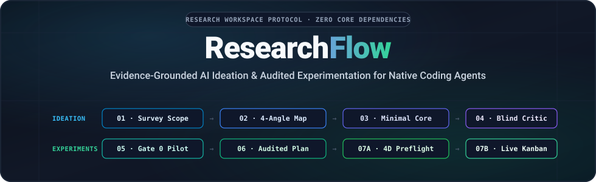
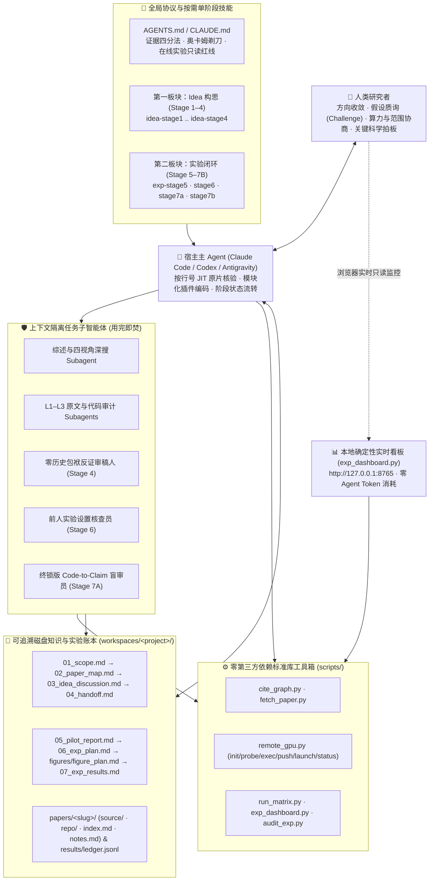

<p align="center">
  
</p>

<h3 align="center">
  <b>不重复造简陋的 Agent 运行时 —— 专注于设计编码智能体做真实科研的证据协议、工程护栏与决策机制。</b>
</h3>

<p align="center">
  <a href="../pyproject.toml"></a>
  <a href="../LICENSE"></a>
  <a href="https://www.python.org/"></a>
  <a href="../pyproject.toml"></a>
  <a href="../AGENTS.md"></a>
  <a href="../tests/"></a>
</p>

<p align="center">
  <a href="../README.md">🇺🇸 English</a> · <b>🇨🇳 简体中文</b>
</p>

<p align="center">
  <a href="#-核心亮点速览">核心亮点</a> ·
  <a href="#-为什么做-researchflow">为什么做 ResearchFlow？</a> ·
  <a href="#️-全栈协议架构">协议架构</a> ·
  <a href="#-八阶段科研全生命周期">八阶段工作流</a> ·
  <a href="#️-与现有开源系统的对比">系统对比</a> ·
  <a href="#-快速开始">快速开始</a> ·
  <a href="#️-零依赖命令行工具箱">命令行工具箱</a>
</p>

---

## ✨ 核心亮点速览

**ResearchFlow** 是一套原生运行在现代编码智能体宿主（**Claude Code**、**Codex**、**Antigravity**）之上的 **科研工作空间协议（Research Workspace Protocol）**。它摒弃了数万行脆弱的自造 Agent 循环，通过**按阶段加载的科研技能（Skills）**、**上下文隔离的独立审计子智能体**与**纯 Python 标准库确定性工具**，贯通从文献调研、极简 Idea 推演到远程多卡实验与数据溯源审计的完整闭环：

| 六大核心能力 | ResearchFlow 具体机制 | 彻底解决的科研翻车痛点 |
| :--- | :--- | :--- |
| **📖 一手源码零损挂载** | `fetch_paper.py` 原封不动解包 arXiv `.tex` 源码、`macros.tex` 并浅克隆官方代码仓，自动生成精确到行号的 `index.md`。 | 告别“800 字摘要→卡片→综述”的传话筒失真与公式脑补。 |
| **🧭 零盲区文献召回** | `cite_graph.py` 融合 S2 + OpenAlex **三桶时间均衡**、本地 `.bib` 二跳共引雷达（`--scan-bib`）与零延迟 arXiv 流（`--arxiv-recent`）。 | 杜绝漏检 0 引用最新撞车预印本、OpenReview 论文与负面反证研究。 |
| **🪒 奥卡姆反拼盘 + 独立盲审** | 严控核心机制在 **1–2 个紧耦合原语**，剥离 `Baseline-Clean` 修 Bug，由零历史包袱 `Critical Reviewer` 跑级联 Python 仿真反证。 | 终结“4 个缺陷焊 4 个补丁”的缝合怪与主窗口确认偏误护短。 |
| **🧪 算力前置确认的 `Gate 0`** | 开跑前强制确认算力（绝不擅占宿主本机），用 1–3 小时受控先导实验（`05_pilot_report.md`）验证生死并做实战减法。 | 防止在未验证核心假设前盲目烧掉上百卡时跑全套大表。 |
| **🛡️ 四维资源护栏 + 终锁盲审** | 模块化插件解耦代码（告别千行大泥球），兜底 `GPU VRAM + CPU RAM + 磁盘 + /tmp 内存盘`，真机全分支 2 步冒烟定型后再做**终锁代码盲审**。 | 杜绝阉割版基线、OOM 乱砍 `batch_size` 改坏等价性、后期爆内存及“改 A 坏 B”次生 Bug。 |
| **📊 零 Token 实时看板与保真审计** | 本地 Web 看板 `exp_dashboard.py` 实时追踪远端进度与显卡状态（0 Token 消耗），严守**在线实验只读红线**，配套 `audit_exp.py` 审计。 | 消除高频定时器刷爆上下文、未经授权擅杀在线实验与画图硬编码假数字。 |

---

## 🔥 版本动态

- **`v0.3.1` — 实战加固与零 Token 实时看板版**：基于真实大模型实验全流程复盘，新增 Stage 6 独立《前人实验设置核查报告》子智能体（`stage6_exp_conventions.md`）、`remote_gpu.py exec` 免引号转义同步执行与 `/tmp` `tmpfs` 自动隔离、模块化代码解耦规范、调整至性能优化定型后的**终锁代码盲审**、在线实验**只读诊断红线**、按需可选时间估算指南，以及零 Token 本地实时看板 [`exp_dashboard.py`](../scripts/exp_dashboard.py)。
- **`v0.3.0` — 实验先导、设计与保真执行闭环（Stage 5 → 7B）**：新增 `Gate 0` 先导定型、“一跑多切”实验与双轨图表规划（`figure_plan.md`）、条件等价显存适配、多卡只增账本队列 [`run_matrix.py`](../scripts/run_matrix.py) 与确定性审计器 [`audit_exp.py`](../scripts/audit_exp.py)。
- **`v0.2.0` — Idea 阶段深度加固版**：升级三桶时间均衡引文网、`--scan-bib` 二跳雷达、`--arxiv-recent`、`--before-date` 历史回测锁、奥卡姆极简预算与跨模块级联数值反证。

---

## 🤔 为什么做 ResearchFlow？

市面上不少开源 Auto-Research 框架主打*“输入一句话，全自动跑完发论文”*，但在真实前沿课题上往往栽倒在两个重灾区：

### 1. Idea 构思阶段的常见崩塌
- **未读文献先射箭**：第 1 步还没看任何真实论文，就靠模型先验瞎编创新点、钦定数据集甚至预估涨点幅度；
- **逐层摘要丢失关键细节**：把摘要压成卡片再拼综述，彻底抹掉了原论文定理隐式条件、附录受控实验和官方代码里的隐藏超参；
- **单窗口长跑失忆**：在同一会话连刷几百步触发多次上下文压缩（Compaction），导致模型半失忆后靠猜测编造参数。

### 2. 实验设计与执行阶段的常见崩塌
- **玩具化降级 vs. 盲目排满交叉乘积**：要么硬塞进单文件跑 8 组 CIFAR/MLP 玩具实验，要么不查同行算力前提（拿单张显卡硬套别人 `8× H100` 的全量数据集与多模型全交叉乘积）导致几十天跑不完；
- **显存不足时静默改坏科学公平性**：遇到 `CUDA OOM` 直接把 `batch_size` 砍半却不翻倍 `grad_accum_steps`，或把统计/投影钩子误绑在微步上，悄悄改变了优化语义；
- **千行单文件大泥球与“先审后改脱审”**：把十几个基线塞进一个 1,600 行的 `if/elif` 脚本，先做完代码审查，后面为了修显存或提速大改几百行引发连环“改 A 坏 B”。

> **ResearchFlow 的核心权限准则 —— 工程自主权与科学决策权严格分离**：
> Agent 拥有充分的**工程自主权**（免密部署环境、剖析算子瓶颈、断点恢复、确定性渲染矢量图表），但**绝不拥有越界的科学篡改权**——未经允许严禁占宿主本机跑模型、严禁测试集调参、严禁静默删种子/条件、严禁擅自杀掉或改动正在运行的在线实验。

---

## 🏛️ 全栈协议架构



---

## 🔬 八阶段科研全生命周期

每个阶段**仅按需加载当前对应的单个 `SKILL.md`**，所有状态实时沉淀至 `workspaces/<project>/`，方便随时通过 `/compact` 或新开干净会话无缝接力，彻底杜绝长上下文失忆。

### 第一板块：实证型 Idea 构思与文献建图（`Stage 1 → 4`）

| 阶段 | 技能入口 | 核心认知与防漂移机制 | 核心落盘产物 |
| :--- | :--- | :--- | :--- |
| **阶段 1**<br/>方向广搜与定界 | [`idea-stage1-landscape`](../skills/idea-stage1-landscape/SKILL.md) | 综述优先梳理分类树（或 **1–3 篇种子论文直入**）；先铺垫精确形式化定义，锁定 `A → B → C` 问题分支。 | `01_scope.md` |
| **阶段 2**<br/>四视角动态建图 | [`idea-stage2-literature-map`](../skills/idea-stage2-literature-map/SKILL.md) | 三桶引文网 + `--arxiv-recent` + OpenReview + 正逆对偶算子 + 负面反证 + `--scan-bib` 二跳共引雷达；并行 `L1–L3` 原文与代码审计。 | `02_paper_map.md`<br/>`papers/*/notes.md` |
| **阶段 3**<br/>受约束极简构思 | [`idea-stage3-ideation`](../skills/idea-stage3-ideation/SKILL.md) | 文献冲突破局与基线代码手术；**1–2 个原语极简上限**；剥离 `Baseline-Clean`；新算子强制回跳查重；区分 `Explore/Challenge/Refine/Pivot`。 | `03_idea_discussion.md` |
| **阶段 4**<br/>独立级联反证 | [`idea-stage4-review-handoff`](../skills/idea-stage4-review-handoff/SKILL.md) | 零历史包袱 `Critical Reviewer`：最小创新核剥离、近邻 `L2` 附录查重、初等闭式占优检验、级联 Python 仿真及 `Gate 0` 先导设计。 | `04_handoff.md`<br/>`critical_review.md` |

### 第二板块：先导定型、实验设计与保真执行（`Stage 5 → 7B`）

| 阶段 | 技能入口 | 核心工程护栏与人类拍板节点（`⏸️`） | 核心落盘产物 |
| :--- | :--- | :--- | :--- |
| **阶段 5**<br/>`Gate 0` 先导定型 | [`exp-stage5-pilot`](../skills/exp-stage5-pilot/SKILL.md) | `⏸️` **前置确认先导算力**（绝不擅跑宿主本机）。经 `remote_gpu.py` 执行单测、15 秒吞吐标定与 1–3h 受控先导验证。`⏸️` **拍板 `GO / SIMPLIFY / PIVOT`**。 | `05_pilot_report.md` |
| **阶段 6**<br/>审计驱动实验设计 | [`exp-stage6-design`](../skills/exp-stage6-design/SKILL.md) | 派子智能体深挖锚点论文 `.tex + repo` 产出《前人实验设置核查报告》（样本规模/同行卡数/主副模型分工）；白话导读 + 拆分**跑卡批次**与**零算力切片**；双轨图表说明书 `figure_plan.md`；按需可选估时。`⏸️` **协商算力与范围**。 | `06_exp_plan.md`<br/>`figures/figure_plan.md`<br/>`exp_manifest.json` |
| **阶段 7A**<br/>四维护栏与终锁盲审 | [`exp-stage7a-coding`](../skills/exp-stage7a-coding/SKILL.md) | 模块化 `methods/*.py` 插件解耦 + 只读 `eval_harness.py` 哈希锁；四维护栏（`VRAM + CPU RAM + 磁盘 + /tmp tmpfs`）；门禁 1（`test_claims.py` + 模拟 OOM）→ 门禁 2（`remote_gpu.py exec` 全分支 2 步真数据冒烟）→ **门禁 3（定型后终锁版 `Code-to-Claim` 独立盲审）**。 | `experiments/*`<br/>`stage7a_code_audit.md` |
| **阶段 7B**<br/>看板执行与保真审计 | [`exp-stage7b-execution`](../skills/exp-stage7b-execution/SKILL.md) | 一机多卡队列 `run_matrix.py` + 只增账本 `ledger.jsonl`（修公共 Bug 用 `invalidate` 防混算）；启动**本地零 Token 实时看板 `exp_dashboard.py`**；严守**在线实验只读红线**；生成 `.pdf/.png` 矢量实验图并通过 `audit_exp.py` 审计。 | `07_exp_results.md`<br/>`figures/*.pdf` |

---

## ⚖️ 与现有开源系统的对比

| 对比维度 | AutoResearchClaw | autoresearch (Karpathy) | Agentic Scientist (v3) | AgentLaboratory | AI-Researcher | **ResearchFlow** |
| :--- | :--- | :--- | :--- | :--- | :--- | :--- |
| **运行载体架构** | 自建 23 阶段重型管线（~7.1 万行） | 宿主编码 Agent + `program.md` | Docker Headless Agent + `SKILL.md` | 自建多角色对话循环 | 自建 Docker 智能体框架 | **原生编码宿主 + 科研工作空间协议（~4,000 行）** |
| **文献阅读与防漏检** | 800 字截断摘要卡片 | 无文献检索 | 写论文阶段后置检索 | 5 篇摘要循环即停 | 给定种子文献 + 翻页读 `.tex` | **三桶引文网 + `.bib` 二跳雷达 + 零删改 `.tex` 与代码审计 (`L0–L3`)** |
| **实验与图表规划** | 提示词写死硬件 + 砍到 `<=8` 条件 | 人工预置 `prepare.py` | 人工/预置 `task.md` | 自由对话无结构矩阵 | 单模型单数据集工程计划 | **子智能体核查同行真实设置 + 一跑多切 + 前置双轨 `figure_plan.md`** |
| **基线保真与硬件适配** | 从零重写基线；OOM 直接砍半 `bs` 改坏等价性 | Run 0 跑原版；锁死 `TOTAL_BS` | 密封裁判容器 + 等时预留 | 单脚本散装代码；LLM 凭感觉打分 | 禁引原仓重写；仅跑 2 轮检查 | **官方 `repo/` 外科复用 + 三层参数公平 + 条件等价验证与四维护栏** |
| **运行监控与结果审计** | 前台阻塞 SSH（断线易丢状态）；正则查数字 | 重定向日志 + `grep`；Git 回滚 | GPU UUID 租约 + `.prov.json` 溯源 | 仅抓 stdout（丢失报错 stderr） | 静态代码阅读打勾 | **守护队列 + 零 Token 本地实时看板 + 只增账本 `ledger.jsonl` + `audit_exp.py`** |

---

## ⚡ 快速开始

### 1. 克隆仓库与可选开发包

[`scripts/`](../scripts/) 下所有核心命令行工具 **100% 基于 Python 3.10+ 标准库**，零依赖开箱即用：

```bash
git clone https://github.com/legend91019/ResearchFlow.git
cd ResearchFlow

# 可选：安装纯 PDF 论文回退解析器（无 LaTeX 源码时使用）与 pytest 测试工具
pip install -e ".[pdf,dev]"
```

### 2. 在 Claude Code / Codex / Antigravity 中直接对话推进

用宿主编码工具打开 `ResearchFlow/` 目录，系统会自动加载 [`AGENTS.md`](../AGENTS.md) / [`CLAUDE.md`](../CLAUDE.md) 并按当前工作区进度挂载对应阶段技能：

```text
# 起点 A（宽泛大方向 → Stage 1）
我想探索大模型持续学习方向，手头可调配单张 24G–48G 显卡。请初始化 workspaces/cl_peft 开始阶段 1 广搜定界。

# 起点 B（已有 1–3 篇种子论文 → 直入 Stage 2）
围绕 O-LoRA (arXiv:2310.14152) 和 InfLoRA (arXiv:2404.00228)，初始化 workspaces/ortho_cl 直接开始阶段 2 四视角深搜与建图。

# 跨板块清窗接力（推荐在进入 Stage 5/6 及 Stage 7A 前新开窗口或 /compact）
请读取 workspaces/ortho_cl/04_handoff.md，按照 ResearchFlow 阶段 5 准备 Gate 0 先导实验。
```

---

## 🛠️ 零依赖命令行工具箱

[`scripts/`](../scripts/) 下全部 6 个脚本均可在任意终端或由 Agent 独立调用：

```bash
# 1. 文献检索雷达：三桶均衡引文网、本地 .bib 二跳共引扫描、近 30 天零延迟 arXiv 预印本流
python scripts/cite_graph.py 2310.14152 --direction both --limit 40 --out search_logs/olora.md
python scripts/cite_graph.py --scan-bib workspaces/demo --year-min 2024 --limit 25
python scripts/cite_graph.py --arxiv-recent "continual learning lora" --days 30

# 2. 原始论文解包：无损提取 .tex 源码、构建行号导航 index.md、浅克隆官方代码库
python scripts/fetch_paper.py --arxiv 2404.00228 --workspace workspaces/demo --slug 2024_inflora \
  --repo https://github.com/liangyanshuo/InfLoRA --role "Direct Baseline"

# 3. 远程 GPU 运维：免转义密码注入密钥、四维硬件/tmpfs 探针、stdin 5秒快检 exec、tar 秒传与守护启动
python scripts/remote_gpu.py init --workspace workspaces/demo --ssh "ssh -p 51263 root@gpu.host" --password-env RF_PW
python scripts/remote_gpu.py probe --workspace workspaces/demo
python scripts/remote_gpu.py exec --workspace workspaces/demo --script experiments/quick_smoke.py --gpu 0
python scripts/remote_gpu.py push --workspace workspaces/demo --src experiments
python scripts/remote_gpu.py launch --workspace workspaces/demo --job-id main_exp --workdir experiments \
  --cmd "python run_matrix.py run --manifest exp_manifest.json --ledger results/ledger.jsonl --gpus 0,1"

# 4. 零 Token 本地实时 Web 看板 (http://127.0.0.1:8765) 与实验结果保真审计
python scripts/exp_dashboard.py --workspace workspaces/demo --job-id main_exp --port 8765
python scripts/audit_exp.py --manifest workspaces/demo/experiments/exp_manifest.json \
  --ledger workspaces/demo/experiments/results/ledger.jsonl --results-md workspaces/demo/07_exp_results.md
```

<details>
<summary>📂 <b>点击展开课题工作空间（<code>workspaces/&lt;project&gt;/</code>）完整产物结构</b></summary>

```text
workspaces/ortho_cl/
├── 01_scope.md                         # 学术分类树、算力边界、锁定的 A→B→C 问题分支
├── 02_paper_map.md                     # 时序演进脉络、机制/混杂矩阵、主实验目录索引
├── 03_idea_discussion.md               # 已验证事实 vs. 工作假设、最小创新核与废案归档
├── 04_handoff.md                       # 代码改动坐标、Gate 0 先导规格与主表靶标
├── 05_pilot_report.md                  # Gate 0 真机实证裁决 (GO / SIMPLIFY / PIVOT) 与吞吐基线
├── 06_exp_plan.md                      # 白话批次导读、跑卡批次 vs. 零算力切片、三层参数公平协议
├── 07_exp_results.md                   # 附带 <!-- @evidence:... --> 溯源标签的完整实验结果报告
├── figures/
│   ├── figure_plan.md                  # 双轨实验图表设计说明书与数据源字段契约
│   └── fig_e1.pdf / fig_e1.png         # 脚本确定性渲染的矢量与高清实验数据图
├── experiments/
│   ├── exp_manifest.json               # 锁定的条件运行队列与评测器 SHA-256
│   ├── eval_harness.py                 # 独立只读数据切分与同口径指标评测器
│   ├── runner.py                       # 共享条件等价训练循环与异常降批恢复
│   ├── methods/                        # 按方法/基线解耦的插件模块
│   ├── plots/                          # 零硬编码的表格与图表生成脚本
│   ├── tests/test_claims.py            # 机制触发、真实样本 Schema 与模拟 OOM 自愈测试
│   └── results/ledger.jsonl            # 只增不删运行账本（含 Git Commit 与失效重跑记录）
├── search_logs/
│   ├── stage2_search_audit.md          # 四视角检索轨迹 + 临界淘汰审计表
│   ├── critical_review.md              # Stage 4 独立级联反证报告
│   ├── stage6_exp_conventions.md       # Stage 6 子智能体核查的前人实验设置与算力真相档案
│   └── stage7a_code_audit.md           # Stage 7A 定型后终锁版代码盲审报告
└── papers/
    └── 2024_inflora/
        ├── source/                     # 一字未改的原始 arXiv .tex 源码与附录
        ├── repo/                       # 锁定 Commit 的官方开源代码仓库
        ├── index.md                    # 精确到行号的宏定义、章节、表格与公式导航索引
        └── notes.md                    # 证据四分法阅读档案（L1–L3）
```

</details>

---

## 🗺️ 演进路线图

- [x] **第一阶段 — 实证型 Idea 讨论与零盲区文献建图（`v0.1`–`v0.2`，已完成）**
- [x] **第二阶段 — `Gate 0` 先导定型与文献审计驱动的实验/图表设计（`v0.3`，已完成）**
- [x] **第三阶段 — 四维资源护栏、多卡队列、零 Token 实时看板与保真度审计（`v0.3.1`，已完成）**
- [ ] **第四阶段 — 科学叙事综合、模型架构框图制作与证据绑定论文撰写（`v0.4`，规划中）**

---

## 🧪 运行测试

```bash
pytest -v
```

---

## 📜 致谢与开源协议

ResearchFlow 的设计吸收了对 [AutoResearchClaw](https://github.com/aiming-lab/AutoResearchClaw)、[autoresearch](https://github.com/karpathy/autoresearch)、[The Agentic Scientist (AI-Scientist-v3)](https://github.com/SakanaAI/AI-Scientist-v3)、[AgentLaboratory](https://github.com/SamuelSchmidgall/AgentLaboratory) 与 [AI-Researcher](https://github.com/HKUDS/AI-Researcher) 的源码级对比分析与真实课题实战经验。

本项目基于 [MIT License](../LICENSE) 开源。
